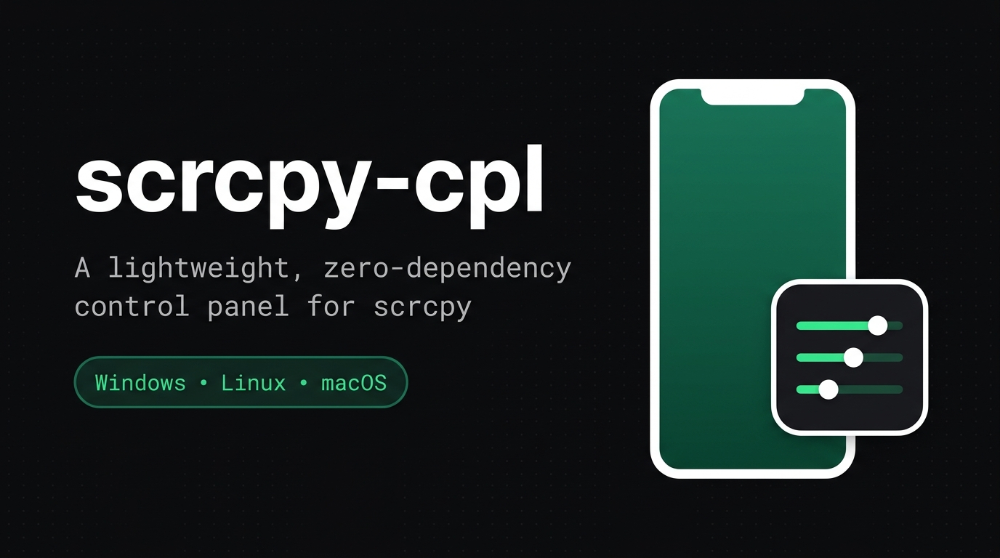

<p align="center">
  
</p>

<p align="center">
  <a href="https://github.com/bimoich/scrcpy-cpl/releases/latest">
    
  </a>
  <a href="https://github.com/bimoich/scrcpy-cpl/actions/workflows/build.yml">
    
  </a>
  
  
  <a href="LICENSE">
    
  </a>
</p>

# scrcpy-cpl

A lightweight, **zero-dependency**, cross-platform GUI control panel & launcher for [`scrcpy`](https://github.com/Genymobile/scrcpy) (v5.0+).
Works natively on **Windows**, **Linux**, and **macOS** using only Python's standard library (`tkinter`).

---

## Why `scrcpy-cpl`?

Most `scrcpy` GUI wrappers are built on heavy frameworks like Electron or Qt (50–150+ MB) and stay resident in memory while you mirror. `scrcpy-cpl` is designed like a classic **Control Panel Applet**:

| Feature | `scrcpy-cpl` | Typical Electron / Qt Wrappers |
| :--- | :--- | :--- |
| **Dependencies** | **Zero** (pure Python stdlib `tkinter`) | Chromium / Qt runtime |
| **RAM During Mirroring** | **0 MB** (auto-closes on launch) | 80–250 MB resident |
| **Binary Trust** | **Zero-Trust** (never downloads silently) | Often bundles or auto-fetches |
| **Layout Stability** | **Fixed-width static grid** (no jitter) | Variable |

---

## Download

Grab the latest standalone executable (no Python required) from [**GitHub Releases**](https://github.com/bimoich/scrcpy-cpl/releases/latest):

| OS | Package | Notes |
| :--- | :--- | :--- |
| **Windows** | `scrcpy-cpl.exe` | Native C/C++ compiled via Nuitka |
| **Linux** | `scrcpy-cpl` | Standalone binary |
| **macOS** | `scrcpy-cpl-macos.zip` | `.app` bundle + binary |

> **Windows SmartScreen Note**: Because this is a free open-source binary without a paid commercial code-signing certificate, Windows Defender SmartScreen may show a *"Windows protected your PC"* prompt when downloaded via a web browser. Click **More info** -> **Run anyway**, or download and launch directly via PowerShell (which avoids browser Mark-of-the-Web flags):
> ```powershell
> irm https://github.com/bimoich/scrcpy-cpl/releases/latest/download/scrcpy-cpl.exe -OutFile scrcpy-cpl.exe; .\scrcpy-cpl.exe
> ```

---

## Key Features

- **Clean Control Panel Applet Design (`.cpl` Inspired)**:
  - Fixed-width static geometry (zero layout shift when switching presets or tabs).
  - **Light Mode** default (Windows Control Panel style) + one-click **Dark Mode** toggle.
  - Built-in **EN / ID** language switcher in the top-right corner (English by default).
- **Zero-Trust / Transparent Dependency Detection**:
  - Never downloads binaries silently in the background.
  - Automatically collapses the dependency banner into a single-line status indicator once `scrcpy` and `adb` are detected.
  - When missing, provides transparent buttons to:
    - Install both `scrcpy` + `adb` via official package managers (`winget`, `brew`, `apt`/`pacman`/`dnf`) or an automatic **PowerShell Official Release Installer** fallback (for Windows systems without `winget`).
    - Select a custom portable folder (`Folder...`).
    - Open official [scrcpy GitHub Releases](https://github.com/Genymobile/scrcpy/releases) or [Official Google ADB Platform-Tools](https://developer.android.com/tools/releases/platform-tools).
- **Smart Presets + Automatic `Custom` Profile**:
  - 6 one-click presets (`Standard`, `Gaming 120`, `Screen Off`, `Virtual Desk`, `Camera`, `OTG Input`) + `Custom`.
  - Remembers your last selected preset across launches.
  - Modifying any option in the collapsible **Advanced Video, Audio & Control Settings** automatically switches to `Custom` and saves your custom configuration.
- **Comprehensive 3-Tab Advanced Panel (Collapsed by Default)**:
  - **Video & Display**: Source, Max Size (`-m`), Max FPS, **Bit Rate (`-b`)**, Video Codec (`h265`/`h264`/`av1`), Capture Orientation, Camera Facing (`back`/`front`/`external`), Flex Virtual Display (`-x`), MP4 Recording (`Save As...`).
  - **Audio & Input**: Audio Source (`output`/`playback`/`mic`/`voice-call`), Audio Codec (`opus`/`aac`/`flac`/`raw`), Audio Duplication (`--audio-dup`), Keyboard/Mouse/Gamepad modes (`sdk`/`uhid`/`aoa`), Read-Only mode (`-n`).
  - **Device & Window**: Turn Screen Off (`-S`), Stay Awake (`-w`), Power Off on Close, Show Touches (`-t`), Always on Top, Fullscreen (`-f`), Borderless Window, Disable PC Screensaver, and custom Extra Flags.
- **Startup Error Catcher & 0 MB RAM Overhead**:
  - Catches immediate `scrcpy` startup errors (e.g., disconnected cable or unauthorized ADB) before auto-closing, displaying the exact error message.
  - Once mirroring starts cleanly, spawns `scrcpy` as an independent detached process and closes the panel.

---

## Run from Source / Build Locally

### Run Directly (Python 3)
```bash
python3 scrcpy_cpl.py
```
- **Windows**: Double-click `run_windows.bat`
- **Linux / macOS**: Run `./run_unix.sh` *(Linux requires `python3-tk`, e.g., `sudo apt install python3-tk`)*

### Build Standalone Executable Locally
```bash
python generate_icon.py
python -m nuitka --onefile --assume-yes-for-downloads --windows-console-mode=disable --enable-plugin=tk-inter --windows-icon-from-ico=scrcpy_cpl.ico --company-name="bmolab" --product-name="scrcpy-cpl" --file-version="1.2.1.0" --product-version="1.2.1.0" --file-description="scrcpy-cpl Control Panel Applet" --output-dir=dist --output-filename=scrcpy-cpl.exe scrcpy_cpl.py
```

---

## License

Licensed under the [MIT License](LICENSE). Copyright (c) 2026 **bmolab**.
